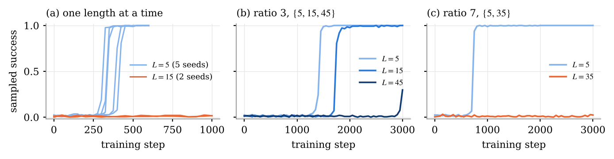
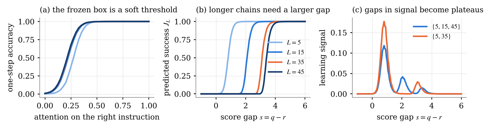

# RLVR Learning Dynamics

A small, readable reproduction of the synthetic experiments in
[*On the Emergence of Implicit Curriculum in RLVR Learning Dynamics*](https://arxiv.org/abs/2602.14872)
(Huang, Wen, Chi, Wei, Singh, Liang and Chen, 2026).

Reinforcement learning with verifiable rewards (RLVR) trains a model with a single pass or fail signal on
its final answer, yet it teaches long chains of reasoning. The paper explains this with an *implicit curriculum*:
when training mixes easy and hard problems, the easy ones are learned first and prepare the model for the hard
ones. Whether the handoff is smooth or stalls depends on how far apart the difficulty levels are.

This repository reimplements the paper's controlled setting in a few hundred lines of PyTorch that run on a
laptop CPU, and reproduces its three core findings.



| Finding in the paper | What we see |
|---|---|
| A short horizon is learned after a plateau, then a sudden jump | Length 5 jumps from chance to 1 at steps 325 to 425 (5 seeds) |
| A long horizon trained alone does not move | Length 15 alone never exceeds 2.3% success in 1,000 steps (2 seeds) |
| A smooth mixture relays progress, a sparse one stalls | Ratio 3: length 15 takes off 300 steps after length 5. Ratio 7: length 35 stays near zero for 2,250 steps after length 5 is solved |

The mixture results use one seed each so far.

## The setting in one paragraph

States and actions are numbers mod 96. A problem of length *L* gives a start state and *L* actions, and the model
must write the chain `y[k+1] = (y[k] + action) % 96`. Only the final state is graded. The actions are not given in
order: each carries a tag, and each answer slot carries the partner tag under a secret codebook, so the model must
learn the codebook to know which action to apply. The model is the one from the paper: a frozen MLP (the "box")
that already knows how to apply one action, and an attention table `Q`, starting at zero, that decides where to
look. RL trains only `Q`, with REINFORCE, a running baseline and outcome reward.

The whole story comes down to one quantity, the per step margin Δ: a chain of *L* steps succeeds with
probability about Δ^L, and its learning signal scales like Δ^L (1 − Δ). A length only teaches while it is neither
hopeless nor solved. The figure below shows this using the frozen box alone, without any RL.



## Quick start

```bash
pip install -r requirements.txt
python run_single.py        # one length at a time, about 10 minutes
python run_mixtures.py      # ratio 3 and ratio 7 mixtures, 20 to 30 minutes per run
python mechanism.py         # the mechanism figure data, about a minute
python make_figures.py      # redraws figures/ from results/
```

The first run trains the one-step box and saves it as `box.pt` (about a minute). The results used for the figures
are already in `results/`, so `make_figures.py` works straight away.

## What is where

| File | What it does |
|---|---|
| `data.py` | The task: tags, the secret codebook, batches of problems |
| `model.py` | The frozen one-step box and the rollout with the attention table `Q` |
| `train.py` | REINFORCE with a per length baseline, evaluation, and take-off times |
| `plots.py` | Two plotting helpers for the notebooks |
| `run_single.py`, `run_mixtures.py`, `mechanism.py` | The experiments behind the figures |
| `make_figures.py` | Draws `figures/` from `results/` |
| `notebooks/` | A guided walk through the task, single lengths and mixtures |

The notebooks are meant to be read in order: `01_task_and_box` builds the task and the box,
`02_one_length` shows the plateau and jump and what `Q` learns, and `03_mixtures` compares the two mixtures.

## Differences from the paper

We follow Sections 3 and 7.1 of the paper with these differences: sampled rather than greedy evaluation, no entropy
penalty, a fixed sharpness factor of 2.3 on the box's logits, a baseline kept separately for each length, and a much
larger step size, so our runs are ten to twenty times shorter than the paper's.

## Citation

If you use this code, please cite the original paper:

```bibtex
@article{huang2026implicit,
  title   = {On the Emergence of Implicit Curriculum in RLVR Learning Dynamics},
  author  = {Huang, Yu and Wen, Zixin and Chi, Yuejie and Wei, Yuting and Singh, Aarti and Liang, Yingbin and Chen, Yuxin},
  journal = {arXiv preprint arXiv:2602.14872},
  year    = {2026}
}
```

This repository was started as a course project for Sequential Decision Making at Yale University, Fall 2026.
